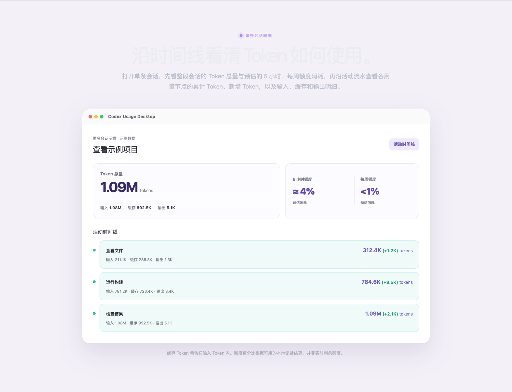
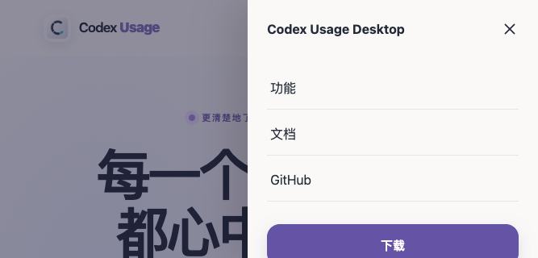

# 网站 UI/UX 审查 — 2026-11-10

原始审查使用本仓库的 [ui-ux-pro-max](.agents/skills/ui-ux-pro-max/SKILL.md)，审查 Astro + React 产品官网。原始结论基于当时源码、生产构建预览和 Playwright CLI 实测；审查阶段没有修改网站实现，也没有部署。后续修复见下文。

## 修复记录 — 2026-11-10

本轮按以下审查落实了全部 9 项实现修复，并保留现有紫色品牌与页面结构。

| 原问题 | 实现 |
| --- | --- |
| 1. 深色会话详情 | 区域表面、标题、说明和注释使用成对主题 token，内部样例产品图保留浅色。 |
| 2. 桌面功能菜单 | 原生 disclosure 暴露展开状态，连接透明命中区域；支持慢速与斜向移入、Tab、Esc 和外部点击，保留功能区直达链接。 |
| 3. Mac 下载选项 | JS 就绪后将回退链接增强为原生按钮，提供 `aria-expanded` / `aria-controls`、Enter / Space、Esc 返回焦点、外部点击和焦点离开关闭。 |
| 4. 短视口手机抽屉 | 使用 `100dvh`、固定顶部关闭区、独立滚动内容区和底部安全空间，保留背景锁定与焦点管理。 |
| 5. 信息文字对比 | 加深文档卡片与侧栏小字、提亮深底页脚文字，分别适配深浅色。 |
| 6. 跳过重复导航 | 首次 Tab 可见的四语言快捷入口；文档直接聚焦文章，其余页面聚焦 main。 |
| 7. 减少动态效果 | 即时锚点滚动、关闭非必要动画和过渡；Tailwind 位移仅在 `motion-safe` 下启用，避免生产 CSS 压缩合并独立变换属性后遗留位移。 |
| 8. 手机触摸控件 | 语言、菜单、关闭控件至少 44×44 CSS px；关闭标签覆盖四语言。 |
| 9. 无 JS 导航 | React 增强前保留原生 details 导航与等价页面语言链接；主下载链接仍进入下载页。 |

同时落实三项后续优化：手机 hero 示意图突出成本、Token 总量与剩余额度；识别平台后 CTA 明示 macOS / Windows，Mac 选项与下载页提供芯片识别帮助；语言入口使用 Globe 图标、可访问名称包含当前语言，并标记当前项。

验收结果：

- `pnpm check`：22 个文件，0 errors / warnings / hints。
- `pnpm build`：73 页构建成功；`pnpm verify`：72 个本地化页面、资源、元数据、sitemap 与下载配置检查通过。
- Playwright CLI 对 `http://127.0.0.1:4322` 的生产构建执行完整回归，四语言 × 六类页面 × 四个宽度的 96 个组合未发现横向溢出。脚本会拒绝开发服务器，避免漏掉仅在 CSS 生产压缩后出现的差异。
- 通过桌面菜单慢速/斜向移入、子链接点击与 Tab/Esc；四语言跳转正文、深浅色信息文字对比、667×320 / 375×812 抽屉滚动与焦点返回、44px 控件尺寸；减少动态效果；Mac 下载 Enter/Space、状态关联、Esc/外部点击/焦点离开关闭；无 JS 手机导航、等价语言页面和下载回退。
- 会话详情标题 / 说明 / 注释的对比度：浅色 **12.20 / 5.03 / 4.56:1**，深色 **12.64 / 7.99 / 7.56:1**；四语言在 375px 与 1440px 下均达标。
- 修复后截图只包含网站样例数据：[深色会话区域](review-assets/ui-ux-2026-11-10/dark-session-fixed.png)、[横屏菜单](review-assets/ui-ux-2026-11-10/landscape-menu-fixed.png)、[手机首屏示意图](review-assets/ui-ux-2026-11-10/mobile-hero-fixed.png)。本轮未部署。

浏览器回归脚本为 [scripts/verify-ui.playwright.js](scripts/verify-ui.playwright.js)，运行方式见 [README](README.md#local-development)。以下审查结论、复现描述与旧截图保留为修复前记录，源码行号可能已移动。

## 结论

紫色品牌色、浅色背景、卡片和主次按钮形成了清晰的视觉体系。首页能解释产品价值，并提供下载、功能介绍和隐私说明。建议保留现有视觉方向，优先修复阅读和导航问题。

共发现 **2 项 P1、7 项 P2**。P1 应优先修复；P2 是下一轮可访问性和交互完善项目。优先级表示本项目修复顺序，不表示正式 WCAG 合规等级。

| 优先级 | 问题 | 影响范围 |
| --- | --- | --- |
| P1 | 深色模式会话详情区浅字配浅底 | 四语言会话分析页 |
| P1 | 桌面功能下拉菜单经过空隙即消失 | 全站桌面导航 |
| P2 | Mac 下载选项缺少状态语义和关闭行为 | 首页、功能详情页的下载入口 |
| P2 | 矮视口下移动菜单内容越出屏幕 | 手机横屏、放大后的窄视口 |
| P2 | 文档入口、侧栏标题和页脚小字对比不足 | 文档与全站页脚 |
| P2 | 缺少跳过重复导航的快捷入口 | 全站，文档页尤为明显 |
| P2 | 减少动态效果设置未生效 | 平滑滚动、按钮和卡片 |
| P2 | 手机图标控件点击区域偏小 | 语言、菜单、关闭按钮 |
| P2 | JS 不可用时手机菜单与语言菜单失效 | 手机导航、全站语言选择 |

## 范围与方法

- 桌面浏览器：Chromium，生产构建通过 `pnpm preview` 本地运行。初查使用开发服务器，随后在生产预览复核主要发现。
- 布局矩阵：英语、简体中文、繁体中文、日语 × 首页、下载页、文档首页、安装指南、会话分析页、成本分析页 × 375 / 700 / 768 / 1440 CSS px，共 96 个页面与宽度组合。
- 矩阵检查文档宽度、越出视口的正文元素、文档导航是否可见；没有发现页面横向溢出，也没有发现文档导航完全消失的断点。
- 交互专项：Mac UA 下的下载菜单、桌面 hover 子菜单、手机抽屉、Esc、焦点返回、文档折叠导航、跨语言保留当前文档、禁用 JS、`prefers-reduced-motion: reduce`。
- 专项视口：375×812 手机竖屏、667×320 手机横屏、1440×1000 桌面。
- 深色模式重点检查中文首页和会话分析模板；未对所有页面执行完整深浅色人工审阅。
- 对比度采用浏览器计算样式中的不透明颜色，按 sRGB 相对亮度公式计算；不是根据截图肉眼估计。
- 依据来自 skill 的 quick reference、UX 数据检索与 Astro hydration 指南。首次宽泛 Astro 检索包含无关结果，收窄到 `client hydration` 后仅采用与当前 React 导航岛有关的建议。
- 未进行真实 VoiceOver/NVDA、Safari/iOS 真机、200%/400% 缩放全量测试或 Lighthouse 性能评估，不将本次审查视为完整合规或性能认证。

## 发现与验收条件

### 1. P1 — 深色模式下会话详情区标题几乎不可读

**位置：** [visuals.css:71](src/styles/visuals.css#L71)、[BaseLayout.astro:54](src/layouts/BaseLayout.astro#L54)、[会话页模板:52](src/pages/%5B...path%5D.astro#L52)。

`.session-detail-section` 固定使用浅色背景 `#f3f0f8`，却没有对应的深色覆盖。系统深色模式下，标题继承 `#ebebf2`，说明文字使用 `#b9bdc9`，注释使用 `#a7a7b7`。

| 文字 | 前景 / 背景 | 实测对比度 |
| --- | --- | --- |
| 大标题 | `#ebebf2` / `#f3f0f8` | 1.05:1 |
| 说明 | `#b9bdc9` / `#f3f0f8` | 1.67:1 |
| 底部注释 | `#a7a7b7` / `#f3f0f8` | 2.10:1 |

**复现：** 系统深色模式，打开 `/zh/session-analysis/`，滚到“沿时间线看清 Token 如何使用”。四语言共用这一模板。

**建议：** 为该区域定义成对的深浅色表面和文字 token；产品示意图可以保留浅色，但其外部标题区必须正确适配主题。

**验收：** 深色模式的大标题至少 3:1，普通说明和注释至少 4.5:1；四语言在桌面与手机下均可读。阈值依据 [W3C 对比度说明](https://www.w3.org/WAI/WCAG22/Understanding/contrast-minimum.html)。

### 2. P1 — 桌面功能下拉菜单存在 hover 断层

**位置：** [BaseLayout.astro:59](src/layouts/BaseLayout.astro#L59)、[global.css:11](src/styles/global.css#L11) 的 `.feature-nav:hover` / `:focus-within`。

1440px 视口下，触发容器位于 y=32–52，弹层从 y=56 开始，中间有 4px 空隙。鼠标向下经过 y=53 时触发区域失去 hover，菜单立即消失；随后移到原菜单位置也无法重新显示。慢速移动指针时无法可靠进入子菜单。快速跳过空隙可能偶尔成功，不能据此判定功能正常。

**复现：** 首页悬停“功能”，向下逐步移动鼠标到第一条子链接。另用键盘聚焦“功能”后按 Esc，弹层仍保持显示。

**建议：** 消除触发器与弹层间的非交互空隙，或用连续的透明命中区域连接；采用带明确展开状态和 Esc 关闭行为的 disclosure。保留可直接进入功能区的入口。

**验收：** 指针慢速、斜向移入子菜单都能保持展开；子链接可点击、可用 Tab 到达；Esc 能关闭而不丢失焦点。参考 [W3C hover/focus 内容说明](https://www.w3.org/WAI/WCAG22/Understanding/content-on-hover-or-focus.html)。

### 3. P2 — Mac 下载菜单没有完整的展开与关闭交互

**位置：** [PrimaryDownload.astro:7](src/components/PrimaryDownload.astro#L7)、[PrimaryDownload.astro:20](src/components/PrimaryDownload.astro#L20)。

Mac UA 下，链接点击被拦截，改为展开 Apple Silicon / Intel Mac 选项。实测展开后按 Esc、点击外部都不会关闭；触发链接的 `aria-expanded`、`aria-controls`、`aria-haspopup` 均为空。它表现为展开控件，却仍仅暴露普通链接语义。下载链接本身存在，可用 Tab 到达；问题在状态、操作预期和关闭行为。

**建议：** 使用带正确 button/disclosure 语义的增强控件，提供展开状态、Esc / 外部点击关闭和稳定焦点处理。保留无 JS 时进入下载页的现有链接回退。

**验收：** Enter / Space 展开；辅助技术能获知展开状态；Esc 关闭并返回触发器；点击外部关闭；Tab 可以进入选项，离开后不会留下遮挡内容的弹层。

### 4. P2 — 手机横屏下抽屉下载按钮越出视口

**位置：** [HeaderControls.tsx:26](src/components/HeaderControls.tsx#L26)。

在 667×320 视口打开菜单，面板 `clientHeight=320`、`scrollHeight=330`，`overflow-y: visible`。下载按钮位于 y=278–330，底部 10px 越出屏幕。面板固定使用 `h-screen`，没有可滚动的内容区。大字号或更短视口会进一步放大问题。

**建议：** 使用动态视口高度和可滚动内容区，保留关闭按钮与底部安全空间。

**验收：** 667×320 和 375×812 下所有菜单项与下载按钮均能完整显示或通过面板滚动到达；打开时背景保持锁定；键盘焦点不会落在不可见区域。

### 5. P2 — 多处信息文字对比度不足

**位置：** [global.css:11](src/styles/global.css#L11) 的 `.doc-card span` / `.docs-sidebar h2`、[BaseLayout.astro:76](src/layouts/BaseLayout.astro#L76)。

| 区域 | 字号 | 前景 / 背景 | 对比度 |
| --- | --- | --- | --- |
| 浅色文档卡片“阅读指南” | 13px | `#8877b5` / `#ffffff` | 3.92:1 |
| 浅色文档侧栏“全部指南” | 12px | `#92909d` / `#f9f8f5` | 2.95:1 |
| 页脚版权与说明 | 12px | `#858995` / `#242632` | 4.30:1 |

**建议：** 调整语义文字 token：浅底上加深，深底上提亮；避免通过透明度继续降低小字辨识度。

**验收：** 上述普通信息文字均达到 4.5:1，并单独验证 hover / focus 状态。产品图内部的微缩标签应另行做可读性优化，不与上述页面文字混为一类。参考 [W3C 对比度说明](https://www.w3.org/WAI/WCAG22/Understanding/contrast-minimum.html)。

### 6. P2 — 键盘用户缺少跳过重复导航的入口

**位置：** [BaseLayout.astro:54](src/layouts/BaseLayout.astro#L54)、[BaseLayout.astro:68](src/layouts/BaseLayout.astro#L68)、[文档侧栏模板:67](src/pages/%5B...path%5D.astro#L67)。

全站没有 skip link，`main` 没有可作为跳转目标的 id。桌面文档页在正文前有页头导航和 11 个指南链接；聚焦“功能”还会展开子链接。仅靠 Tab 的用户每次换页都要重复经过导航。现有 `main` 和文章标题有利于屏幕阅读器结构导航，但没有提供同样直接的页面内键盘快捷入口。

**建议：** 在页面开头添加仅在聚焦时显示的“跳到主要内容”；文档页应直接跳到文章，避免仍停在侧栏之前。

**验收：** 首次 Tab 即可看到入口，激活后视口和焦点移动到正文，下一次 Tab 从正文合理位置继续；四语言均有本地化标签。参考 [W3C 绕过重复区块说明](https://www.w3.org/WAI/WCAG22/Understanding/bypass-blocks.html)。

### 7. P2 — 减少动态效果偏好没有覆盖滚动和位移

**位置：** [BaseLayout.astro:20](src/layouts/BaseLayout.astro#L20)、[Home.astro:26](src/components/Home.astro#L26)、[global.css:11](src/styles/global.css#L11)。

模拟 `prefers-reduced-motion: reduce` 后，`html` 仍为 `scroll-behavior: smooth`，按钮和卡片仍分别保留 0.2s / 0.25s 的过渡及 hover 位移。源码没有对应的 reduced-motion 规则。

**建议：** 在减少动态效果模式下将锚点滚动改为即时滚动，移除非必要位移；保留即时的颜色、边框或其他状态反馈。

**验收：** 开启减少动态效果后，功能锚点不再平滑移动，按钮与卡片不再抬升；普通模式保留当前轻量效果。

### 8. P2 — 手机图标控件触摸区域偏小

**位置：** [HeaderControls.tsx:13](src/components/HeaderControls.tsx#L13)、[HeaderControls.tsx:23](src/components/HeaderControls.tsx#L23)、[HeaderControls.tsx:27](src/components/HeaderControls.tsx#L27)。

375×812 下实测语言按钮约 47×26px，菜单按钮 38×38px，关闭按钮 22×22px。关闭控件没有额外 padding，要求较精准地点击。其标签固定为英文 `Close menu`，没有跟随当前中文或日语界面。

**建议：** 为这三个手机图标按钮提供至少 44×44 CSS px 的实用点击区域，图形本身可保持现有大小；关闭标签纳入本地化。

**验收：** 实测命中框达到建议尺寸、无重叠、焦点指示完整，四语言关闭标签正确。

这里的 44px 是本次触摸体验建议，并不等同于 WCAG AA 的硬性尺寸。WCAG 2.2 的 Web 最小目标要求为 24×24 CSS px，且存在间距等例外；仅凭 22px 尺寸不能直接断言不合规。见 [W3C 目标尺寸说明](https://www.w3.org/WAI/WCAG22/Understanding/target-size-minimum.html)。

### 9. P2 — JS 失效时手机主导航和语言选择不可操作

**位置：** [BaseLayout.astro:65](src/layouts/BaseLayout.astro#L65)、[HeaderControls.tsx:12](src/components/HeaderControls.tsx#L12)、[HeaderControls.tsx:22](src/components/HeaderControls.tsx#L22)。

禁用 JS、375×812 打开首页，点击“打开菜单”没有出现 dialog；语言按钮同样依赖 React hydration，静态 HTML 中没有可访问的语言链接列表。桌面导航在手机断点被隐藏，用户只能滚到页脚寻找文档等链接。首页下载链接仍能进入 `/zh/download/`，这一回退应保留。

**建议：** 为关键导航和语言列表提供原生 disclosure / 普通链接回退；增强脚本加载完成后再接管。至少不要在脚本不可用时保留看似可用但无响应的按钮。

**验收：** 禁用 JS 后，窄屏仍能通过页头进入文档、功能与下载页，并切换到其他语言的等价页面；开启 JS 时仍支持现有焦点管理。

## 视觉与信息层级的后续优化

以下是设计优化方向，未计入上面的 9 项可复现问题，也没有数据证明它们会提升转化：

1. **手机产品图优先展示关键指标。** 当前示意图局部标签小至 7–10px。可将手机 hero 改为聚焦成本、Token 总量和剩余额度的局部视图，或提供明确的放大入口；不必让完整桌面布局在小屏全部可读。
2. **让下载选择更容易理解。** Mac 下载区可补充“如何判断芯片”的简短帮助；主 CTA 可以在识别平台后明确写出平台，避免同一“免费下载”在不同平台分别表现为弹层和文件下载。
3. **统一语言入口和控件文案。** 将 `◎` 换成与现有 Lucide 图标一致的 Globe 图形；桌面语言按钮的可访问名称可包含当前语言，选择列表可标记当前项。移动关闭文案修复见问题 8。

## 已确认的优点与检查结果

- 首屏下载 CTA 与次级入口区分清晰；下载按钮高度为 52px。
- 四语言的 96 个布局组合未检出横向溢出；文档导航在抽测断点均可见。
- 手机文档原生折叠导航可展开并跳转到其他指南。
- 从中文额度指南切换日语，路径正确保留为 `/ja/docs/quota/`。
- React 手机菜单支持 Esc 关闭，并在关闭后将焦点返回菜单按钮。
- 页面有正确的 viewport、语言属性、清晰的 h1 和正文层级。
- 用量与会话图使用样例内容并有示意数据说明；本报告附图仅包含网站样例内容，没有加入本机真实会话、账户或用量数据。
- `pnpm check`：21 个文件，0 errors / warnings / hints。
- `pnpm build`：73 页构建成功。
- `pnpm verify`：72 个本地化页面、站内资源、元数据、sitemap 和下载链接配置检查通过。该脚本验证链接配置，不验证 GitHub 线上安装包是否可下载。
- 浏览器观察到 Google Analytics 收集请求 `ERR_CONNECTION_CLOSED`；未将外部统计请求错误当作网站交互失败。未进行线上部署或安装包下载验证。

原始审查交付为本文和两张修复前样例截图；后续实现与验证以文首修复记录为准。
